# Ardudino

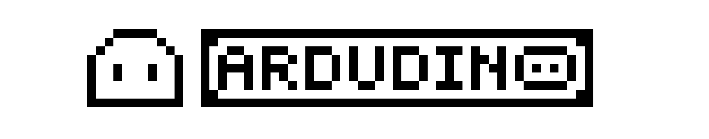

Ardudino is a simple **virtual pet game for Arduboy**, inspired by classic handheld pets like Dinkie Dino and early Tamagotchi-style games.

You take care of a small creature by managing its basic needs, interacting with it, and keeping it healthy and happy over time.

The game is designed to be **lightweight, easy to understand, and fully compatible with Arduboy hardware limitations**.

---

## Testar no emulador

Veja [TESTAR.md](TESTAR.md) para abrir a demo no Ardens, escolher cenários e executar os testes AVR.
As melhorias implementadas e próximas sugestões estão em [ROADMAP.md](ROADMAP.md).

## Controls

- **LEFT / RIGHT**: Switch menu columns
- **UP / DOWN**: Navigate icons or change submenu options
- **B**: Confirm / Select
- **A**: Back / Cancel; on the main pet screen, save immediately

---

## Start Screen

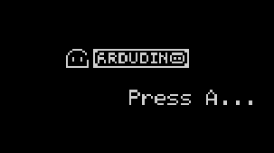

Press **A** to start the game.

---

## Gameplay Overview

The main screen shows your creature inside a central viewport, with side menus used to interact with it.

Each action affects the creature’s internal state, such as hunger, thirst, happiness, temperature, and health.

---

## Menus

### Drink

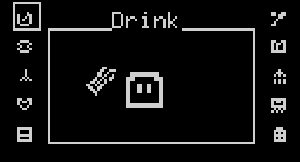

Gives water to your creature.

- Increases **thirst**
- Has no effect if the creature is already hydrated

---

### Food

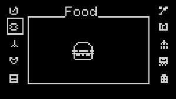

Feed your creature with different types of food.

Available options:

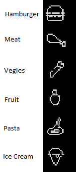

Each food affects **hunger** and **happiness** in different ways.

---

### Light

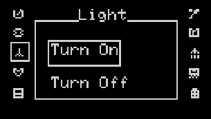

Turns the light **ON** or **OFF**. Sleep follows the game clock (21:00 to 09:00).

- When the light is OFF:
  - Most menus are locked
  - Only **Status** and **Light** menus remain accessible

---

### Caress

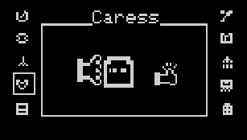

Interact with the creature to show affection.

- Increases **happiness**
- Triggers a short animation

---

### Status

The status menu is divided into multiple screens:

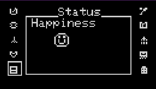
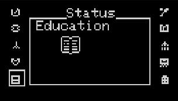
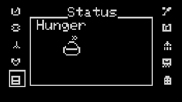
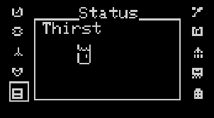
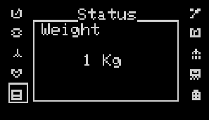
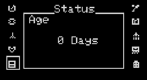
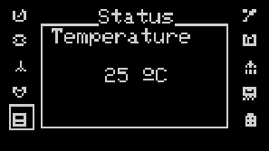

They show information such as:

- Happiness
- Education
- Hunger
- Thirst
- Weight
- Age
- Temperature

---

### Play

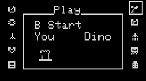

Play a **Rock / Paper / Scissors** minigame against the creature.

- Always played in **5 rounds**
- Cannot be exited before finishing
- Let the dino win at least three rounds to increase its happiness
- Y/D show your wins and the dino’s wins

---

### Study

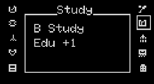

Teach your creature.

- Increases **education**
- May slightly affect happiness
- Includes a short study animation

---

### Shower

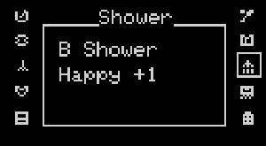

Give the creature a shower.

- Improves **happiness**
- Removes accumulated dirt
- Displays a shower animation

---

### Climate

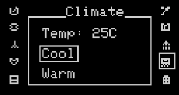

Adjust the environment temperature.

- Temperature affects health
- Extreme values can make the creature sick

---

### Heal

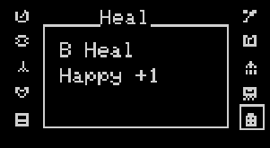

Use medicine to heal the creature.

- Only works when the creature is sick
- Cures illness; food, water, climate and hygiene still need care

---

## Health and Sleep

- Two consecutive unhealthy two-hour ticks can cause **persistent illness**:
  - Temperature outside 18–30°C
  - Empty food or water, maximum dirt, or sleeping with lights on
- Medicine only works when the creature is sick
- Sleeping in darkness improves happiness; lights turn on automatically at 09:00

---

## Goal

There is no strict win condition.

The goal is to **raise a dinosaur and keep it healthy and happy**.
Death and a new-generation flow are still planned.

---

## Growth and persistence

Meat/burgers, plants/fruit, and pasta vote for T-Rex, Bronto, and Tricera during the
baby stage. At age 2, the dominant group locks the species; tied or absent votes
produce Tricera. Ice cream improves mood without a diet vote. At age 5, the sprite
gains an adult tail extension. Status includes Hygiene, Growth and Health pages.

Each awake two-hour tick consumes water and adds dirt. Babies consume one food
unit per tick; older pets consume one every other tick. Meat and vegetables fill
two units; other foods fill one. Shower clears dirt. The home screen names the
highest-priority need and gives a rate-limited beep when it changes.

Saves include species, diet, hygiene, illness and metabolism progress. New writes
start at EEPROM address 16; valid v1 saves migrate from their original location.
Autosave runs every five real minutes. Press A on the main pet screen before closing.
The normal build uses real-time minutes; the demo uses one second per game minute.
Time advances only while running, after the title screen.

These are adapted rules. See the historical references and remaining ideas in
[ROADMAP.md](ROADMAP.md).

## Technical Notes

- Built using **Arduboy2**
- Designed for **ATmega32U4**
- Uses fixed-size bitmap matrices for sprites
- Optimized for low memory usage

---

## License

This project is open source and intended for educational and hobby purposes.
